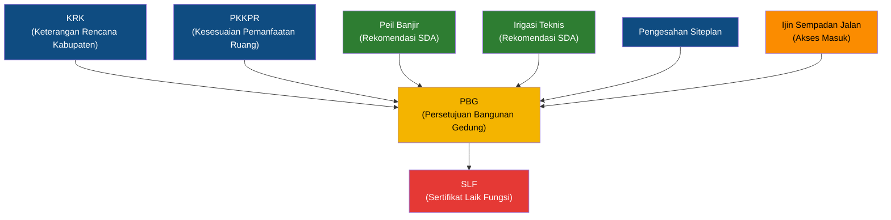

# 📚 KNOWLEDGE BASE PELAYANAN PUBLIK DINAS PUPR KABUPATEN GARUT

## Sumber: Google Drive "00. Pelayanan Publik PUPR"
## Untuk: PURI AI BOT (Pelayanan Umum Responsif dan Informatif)

> **Dokumen ini adalah Knowledge Base resmi** yang digunakan oleh AI BOT PURI untuk menjawab pertanyaan masyarakat terkait pelayanan publik di Dinas Pekerjaan Umum dan Penataan Ruang (PUPR) Kabupaten Garut.
>
> **Status**: IMPLEMENTED — Belum sepenuhnya terverifikasi terhadap dokumen asli PDF karena keterbatasan akses langsung ke konten PDF Google Drive.
>
> **Catatan Integritas**: Knowledge ini disusun berdasarkan inventaris file, nama dokumen, struktur folder, dan konteks yang tersedia dari folder Google Drive `1OHEwrRFvizCgdwFFq-u5C8SSu5XWxtfw`. Konten detail PDF perlu diverifikasi manual oleh tim Dinas PUPR.

---

## DAFTAR 8 PELAYANAN PUBLIK DINAS PUPR KABUPATEN GARUT

| No | Kode | Nama Pelayanan | Bidang |
|:--|:--|:--|:--|
| 01.a | KRK | Keterangan Rencana Kabupaten | Penataan Ruang |
| 01.b | PKKPR | Persetujuan Kesesuaian Kegiatan Pemanfaatan Ruang | Penataan Ruang |
| 02 | PEIL_BANJIR | Rekomendasi Peil Banjir | Sumber Daya Air (SDA) |
| 03 | IRIGASI | Rekomendasi Teknis Irigasi | Sumber Daya Air (SDA) |
| 04 | SEMPADAN_JALAN | Ijin Pemanfaatan Sempadan Jalan (Akses Masuk) | Bina Marga |
| 05 | SITEPLAN | Pengesahan Siteplan | Penataan Ruang |
| 06 | PBG | Persetujuan Bangunan Gedung | Bangunan Gedung |
| 07 | SLF | Sertifikat Laik Fungsi | Bangunan Gedung |
| 08 | PERATURAN | Regulasi dan Peraturan Terkait | Seluruh Bidang |

---

## 01.a. KRK — KETERANGAN RENCANA KABUPATEN

### Definisi
KRK (Keterangan Rencana Kabupaten) adalah dokumen yang memberikan informasi tentang rencana tata ruang pada suatu lokasi tertentu. KRK memuat informasi mengenai peruntukan lahan, intensitas pemanfaatan ruang (KDB, KLB, KDH), GSB (Garis Sempadan Bangunan), ketinggian bangunan maksimal, dan ketentuan teknis lainnya yang berlaku pada lokasi yang dimohon.

### Bidang Penanggung Jawab
**Bidang Penataan Ruang** — Dinas PUPR Kabupaten Garut

### Kata Kunci AI
`krk`, `keterangan rencana`, `rencana kabupaten`, `peruntukan lahan`, `kdb`, `klb`, `kdh`, `gsb`, `garis sempadan`, `ketinggian bangunan`, `tata ruang`, `zonasi`

### Persyaratan Permohonan KRK (Keterangan Rencana Kota/Kabupaten)

1. Surat Permohonan
2. KTP Pemohon
3. Fotocopy Sertifikat Tanah
4. Gambar Batas Lahan berupa polygon dengan format shp (beserta extensionnya) atau format KML/KMZ

### Alur Proses KRK
Berdasarkan **"ALur Proses KRK.png"**:

```
Pemohon Mengajukan Surat Permohonan
           │
           ▼
Verifikasi Berkas oleh Petugas
           │
           ▼
Survey Lokasi oleh Tim Teknis
           │
           ▼
Analisis Kesesuaian dengan RTRW/RDTR
           │
           ▼
Penyusunan Dokumen KRK
           │
           ▼
Penandatanganan oleh Kepala Dinas
           │
           ▼
KRK Diterbitkan dan Diserahkan ke Pemohon
```

### Informasi Penting KRK
- KRK **wajib dimiliki** sebelum mengajukan PBG (Persetujuan Bangunan Gedung)
- KRK berlaku sesuai masa berlaku yang tercantum dalam dokumen
- KRK memuat informasi: GSB, KDB, KLB, KDH, tinggi bangunan maksimum, peruntukan kawasan
- Gratis / tidak dipungut biaya retribusi (tergantung Perda/Perbup yang berlaku)

### Contoh FAQ KRK

**Q: Apa itu KRK?**
A: KRK (Keterangan Rencana Kabupaten) adalah dokumen informasi tentang rencana tata ruang di lokasi tertentu, memuat peruntukan lahan, KDB, KLB, KDH, GSB, dan ketentuan teknis bangunan yang berlaku.

**Q: Apa saja syarat mengurus KRK?**
A: Surat permohonan, fotokopi KTP, fotokopi sertifikat tanah, peta/denah lokasi, koordinat, dan rencana penggunaan lahan.

**Q: Berapa lama proses KRK?**
A: Proses KRK memerlukan waktu sesuai SOP yang berlaku setelah berkas lengkap diverifikasi dan survey lokasi dilaksanakan.

**Q: Apakah KRK diperlukan sebelum mengurus PBG?**
A: Ya, KRK merupakan salah satu dokumen prasyarat dalam pengajuan PBG.

---

## 01.b. PKKPR — PERSETUJUAN KESESUAIAN KEGIATAN PEMANFAATAN RUANG

### Definisi
PKKPR (Persetujuan Kesesuaian Kegiatan Pemanfaatan Ruang) adalah dokumen yang menyatakan bahwa rencana kegiatan pemanfaatan ruang sesuai dengan rencana tata ruang wilayah. PKKPR menggantikan fungsi Izin Lokasi dan merupakan bagian dari perizinan berusaha melalui sistem OSS (Online Single Submission).

### Bidang Penanggung Jawab
**Bidang Penataan Ruang** — Dinas PUPR Kabupaten Garut

### Kata Kunci AI
`pkkpr`, `kkpr`, `kesesuaian kegiatan`, `pemanfaatan ruang`, `izin lokasi`, `oss`, `tata ruang`, `peruntukan`, `rtrw`, `rdtr`

### Dokumen Referensi
1. **cek permohonan.pdf** — Panduan pengecekan status permohonan PKKPR
2. **costumer journey kkpr.png** — Alur pelayanan PKKPR (Customer Journey)
3. **Panduan PNBP ATM.pdf** — Panduan pembayaran PNBP (Penerimaan Negara Bukan Pajak) melalui ATM
4. **Pendaftaran OSS (KKPR).pdf** — Panduan pendaftaran KKPR melalui sistem OSS
5. **poster kkpr utk pemohon.pdf** — Poster informasi KKPR untuk pemohon

### Alur Permohonan PKKPR (Customer Journey)

```
Pemohon Login ke OSS (oss.go.id)
           │
           ▼
Mengisi Data Permohonan KKPR di OSS
           │
           ▼
Upload Dokumen Persyaratan
           │
           ▼
Verifikasi oleh Petugas Dinas PUPR
           │
           ▼
Pembayaran PNBP (via ATM/Bank)
           │
           ▼
Analisis Teknis Kesesuaian Ruang
           │
           ▼
Penerbitan PKKPR melalui OSS
           │
           ▼
Pemohon Download Dokumen PKKPR dari OSS
```

### Persyaratan PKKPR
1. **Akun OSS** yang sudah terverifikasi
2. **NIB (Nomor Induk Berusaha)**
3. **Koordinat Lokasi** yang dimohon
4. **Rencana Kegiatan** yang jelas
5. **Dokumen Pendukung** sesuai jenis kegiatan
6. **Pembayaran PNBP** sesuai ketentuan

### Informasi Penting PKKPR
- PKKPR diproses melalui sistem **OSS (Online Single Submission)** di oss.go.id
- Pembayaran PNBP dapat dilakukan melalui ATM sesuai panduan
- PKKPR merupakan pengganti Izin Lokasi (berdasarkan UU Cipta Kerja)
- Status permohonan dapat dicek secara online

### Contoh FAQ PKKPR

**Q: Apa itu PKKPR/KKPR?**
A: PKKPR adalah Persetujuan Kesesuaian Kegiatan Pemanfaatan Ruang, yaitu dokumen yang menyatakan rencana kegiatan Anda sesuai dengan rencana tata ruang wilayah. Proses ini dilakukan melalui sistem OSS (oss.go.id).

**Q: Bagaimana cara mengurus KKPR?**
A: Anda perlu login ke OSS (oss.go.id), mengisi data permohonan, upload dokumen persyaratan, dan melakukan pembayaran PNBP. Setelah diverifikasi oleh Dinas PUPR, PKKPR akan diterbitkan melalui OSS.

**Q: Bagaimana cara membayar PNBP untuk KKPR?**
A: Pembayaran PNBP dapat dilakukan melalui ATM sesuai panduan yang tersedia. Silakan lihat panduan pembayaran PNBP ATM.

---

## 02. REKOMENDASI PEIL BANJIR

### Definisi
Rekomendasi Peil Banjir adalah surat rekomendasi teknis yang memuat informasi tentang elevasi banjir pada lokasi tertentu. Rekomendasi ini diperlukan sebagai dasar perencanaan pembangunan agar bangunan aman dari dampak banjir.

### Bidang Penanggung Jawab
**Bidang Sumber Daya Air (SDA)** — Dinas PUPR Kabupaten Garut

### Kata Kunci AI
`peil banjir`, `rekomendasi peil`, `elevasi banjir`, `banjir`, `genangan`, `ketinggian air`, `sda`, `sumber daya air`

### Dokumen Referensi
1. **1. SURAT PERMOHONAN.docx** — Template surat permohonan rekomendasi peil banjir
2. **2. SYARAT DAN SOP REKOMENDASI PEIL BANJIR 2024.pdf** — Syarat dan SOP lengkap
3. **3. FLOW CHART PERIJINAN.pdf** — Flow chart alur perizinan

### Persyaratan Rekomendasi Peil Banjir

1. Surat permohonan disertai fotocopy KTP/identitas pemohon; 
2. Bukti Kepemilikan lahan yang dikuasi oleh pemohon; 
3. Fotocopy  Keterangan Rencana Kota (KRK)  Fotocopy dokumen lingkungan UPL/UKL/AMDAL (atau dibuat bersamaan dengan peil banjir); Rencana site plan; 
4. Denah dan peta lokasi yang diajukan; 
5. Data ukur elevasi rencana pembangunan; Gambar rencana drainase disertai elevasi; 
6. Kajian teknis sistem drainase; 
7. Foto lokasi dan saluran sekitar; 
8. Surat keterangan Kepala Desa bila limpasan air akan memakai saluran desa;

### Alur Proses Rekomendasi Peil Banjir

```
Pemohon Mengajukan Surat Permohonan + Berkas
           │
           ▼
Verifikasi Kelengkapan Berkas
           │
           ▼
Survey Lapangan oleh Tim Teknis SDA
           │
           ▼
Analisis Teknis Peil Banjir
(Elevasi, historis banjir, kondisi drainase)
           │
           ▼
Penyusunan Rekomendasi Teknis
           │
           ▼
Penandatanganan Rekomendasi
           │
           ▼
Rekomendasi Peil Banjir Diterbitkan
```

### Informasi Penting Peil Banjir
- Rekomendasi Peil Banjir diperlukan sebagai **salah satu persyaratan PBG** untuk lokasi rawan banjir
- Tim teknis akan melakukan **survey lapangan** untuk menentukan elevasi banjir
- SOP mengacu pada ketentuan tahun 2024
- Gratis / tidak dipungut biaya

### Contoh FAQ Peil Banjir

**Q: Apa itu Rekomendasi Peil Banjir?**
A: Rekomendasi Peil Banjir adalah surat rekomendasi teknis dari Dinas PUPR yang memuat informasi tentang elevasi banjir pada lokasi tertentu, sebagai dasar perencanaan pembangunan agar aman dari banjir.

**Q: Kapan saya memerlukan Rekomendasi Peil Banjir?**
A: Rekomendasi Peil Banjir diperlukan saat Anda akan membangun di lokasi yang berpotensi terdampak banjir, terutama sebagai persyaratan pelengkap PBG.

---

## 03. REKOMENDASI TEKNIS IRIGASI

### Definisi
Rekomendasi Teknis Irigasi adalah surat rekomendasi yang diberikan terkait pemanfaatan atau perubahan pada jaringan irigasi teknis. Rekomendasi ini diperlukan untuk memastikan kegiatan pembangunan tidak mengganggu fungsi irigasi.

### Bidang Penanggung Jawab
**Bidang Sumber Daya Air (SDA)** — Dinas PUPR Kabupaten Garut

### Kata Kunci AI
`irigasi`, `irigasi teknis`, `saluran irigasi`, `rekomendasi irigasi`, `bendung`, `pintu air`, `sawah`, `pengairan`

### Persyaratan Rekomendasi Irigasi Teknis

a. Surat permohonan disertai fotocopy KTP/identitas pemohon; 
b. Fotocopy  Keterangan Rencana Kota (KRK);  
c. Rencana site plan; 
d. Sertifikat sesuai lahan yang dikuasi oleh pemohon; 
e. Denah dan peta lokasi yang diajukan;

### Informasi Penting Irigasi Teknis
- Rekomendasi diperlukan jika pembangunan berdekatan atau melintas jaringan irigasi
- Tim SDA akan melakukan survey dan analisis dampak terhadap jaringan irigasi
- Bertujuan melindungi fungsi irigasi untuk pertanian

### Contoh FAQ Irigasi

**Q: Kapan saya memerlukan Rekomendasi Teknis Irigasi?**
A: Rekomendasi Teknis Irigasi diperlukan jika rencana pembangunan Anda berdekatan atau bersinggungan dengan jaringan irigasi teknis, untuk memastikan tidak mengganggu fungsi pengairan.

---

## 04. IJIN PEMANFAATAN SEMPADAN JALAN (AKSES MASUK)

### Definisi
Ijin Pemanfaatan Sempadan Jalan adalah izin yang diberikan untuk pemanfaatan ruang sempadan jalan, termasuk pembuatan akses masuk (jalan masuk) dari jalan kabupaten ke properti/lahan pemohon.

### Bidang Penanggung Jawab
**Bidang Bina Marga** — Dinas PUPR Kabupaten Garut

### Kata Kunci AI
`sempadan jalan`, `akses masuk`, `jalan masuk`, `ijin sempadan`, `pemanfaatan sempadan`, `bina marga`, `trotoar`, `bahu jalan`

### Sub-Dokumen
Folder ini berisi 3 subfolder dan 1 gambar:
1. **Penjelasan Teknis/** — Berisi penjelasan teknis terkait sempadan jalan
   - **Hunian/** — Penjelasan teknis untuk bangunan hunian
   - **Non Hunian/** — Penjelasan teknis untuk bangunan non-hunian
2. **Persyaratan/** — Berisi dokumen persyaratan
   - **SOP SLF.pdf** — Dokumen SOP terkait (kemungkinan SOP umum yang juga berlaku)
3. **SOP/** — Berisi SOP pelayanan
   - **Buku Saku SLF 2024.pdf** — Buku saku referensi
   - **Proses SLF.pdf** — Alur proses
4. **Hotline puri117** — Gambar informasi hotline PURI 117

### Persyaratan Rumija / Akses Jalan Masuk / Bagian-Bagian Jalan / Rekomendasi Teknis Pemakaian Ruang Milik Jalan

1. Surat Permohonan
2. Photo Copy KTP ( Jika Pemohon Perorangan )
3. Gambar Pra Site Plane Dan Gambar – Gambar Lain nya 
4. Surat Pernyataan

### Alur Proses

```
Pemohon Mengajukan Surat Permohonan
           │
           ▼
Verifikasi Berkas oleh Petugas Bina Marga
           │
           ▼
Survey Lapangan oleh Tim Teknis
           │
           ▼
Analisis Teknis (dampak terhadap jalan kabupaten)
           │
           ▼
Penerbitan Rekomendasi/Izin
```

### Contoh FAQ Sempadan Jalan

**Q: Apa itu Ijin Pemanfaatan Sempadan Jalan?**
A: Ijin Pemanfaatan Sempadan Jalan adalah izin untuk memanfaatkan ruang sempadan jalan, termasuk membuat akses masuk (jalan masuk) dari jalan kabupaten ke lahan Anda. Izin ini dikelola oleh Bidang Bina Marga.

**Q: Apakah saya perlu izin untuk membuat akses masuk dari jalan raya ke rumah saya?**
A: Ya, pembuatan akses masuk dari jalan kabupaten memerlukan izin pemanfaatan sempadan jalan dari Dinas PUPR Kabupaten Garut, Bidang Bina Marga.

---

## 05. PENGESAHAN SITEPLAN

### Definisi
Pengesahan Siteplan adalah proses pengesahan rencana tapak (site plan) suatu kawasan pembangunan oleh Dinas PUPR. Siteplan memuat tata letak bangunan, jalan internal, saluran drainase, ruang terbuka hijau, dan utilitas dalam suatu kawasan.

### Bidang Penanggung Jawab
**Bidang Penataan Ruang** — Dinas PUPR Kabupaten Garut

### Kata Kunci AI
`siteplan`, `site plan`, `rencana tapak`, `pengesahan siteplan`, `tata letak`, `kawasan`, `perumahan`, `pengembang`, `developer`

### Dokumen Referensi (dari folder 08. PERATURAN)
- **Surat permhn Siteplan.docx** — Template surat permohonan pengesahan siteplan
- **WhatsApp Image** — Gambar/informasi pendukung

### Persyaratan Pengesahan Site Plan

1. Fotocopy Keterangan Rencana Kota (KRK) dari Dinas PUPR Kab Garut
2. Fotocopy dokumen KKPR atau pernyataan mandiri usaha mikro atau usaha kecil terkait tata ruang
3. Fotocopy NIB yang telah terbit
4. Fotocopy Dokumen Lingkungan seperti PKPLH/UKL-UPL/Amdal
5. Fotocopy Dokumen kepemilikan lahan seperti sertifikat hak milik/SPH/AJB dengan total luas sesuai dengan luasan permohonan site plan
6. Fotocopy Rekomendasi Peil Banjir dari Dinas PUPR Kab. Garut
7. Fotocopy Rekomendasi Andalalin (dishub dan polres)
8. Fotocopy Rekomendasi Damkar dari Dinas Pemadam Kebakaran
9. Fotocopy Rekomendasi atau surat keterangan lahan tidak produktif dari Dinas Pertanian Kab Garut(apabila peruntukan lahan secara tata ruang masuk ke dalam Kawasan pertanian)
10. Fotocopy Rekomendasi Irigasi Teknis dari Dinas PUPR Kab. Garut(apabila lokasi berada di dekat area irigasi)
11. Fotocopy surat keterangan penyedian Tempat Pemakaman Umum (sebesar 2% dari luas lahan) dari desa lokasi TPU dengan disertai titik koordinat dan bukti kepemilikan lahan untuk penyediaan TPU
12. Fotocopy Rekomendasi Pemanfaatan Bagian Jalan dari Dinas PUPR Kab Garut

### Contoh FAQ Siteplan

**Q: Apa itu Pengesahan Siteplan?**
A: Pengesahan Siteplan adalah proses persetujuan rencana tapak suatu kawasan pembangunan oleh Dinas PUPR, memuat tata letak bangunan, jalan, drainase, RTH, dan utilitas.

**Q: Siapa yang perlu mengurus Pengesahan Siteplan?**
A: Pengembang (developer) perumahan, kawasan industri, atau kawasan komersial yang akan membangun pada lahan lebih dari 5.000 m² umumnya memerlukan pengesahan siteplan.

---

## 06. PBG — PERSETUJUAN BANGUNAN GEDUNG

### Definisi
PBG (Persetujuan Bangunan Gedung) adalah perizinan yang diberikan kepada pemilik bangunan gedung untuk membangun baru, mengubah, memperluas, mengurangi, dan/atau merawat bangunan gedung sesuai dengan standar teknis bangunan gedung. PBG menggantikan IMB (Izin Mendirikan Bangunan).

### Bidang Penanggung Jawab
**Bidang Bangunan Gedung** — Dinas PUPR Kabupaten Garut

### Kata Kunci AI
`pbg`, `persetujuan bangunan`, `bangunan gedung`, `imb`, `izin mendirikan bangunan`, `simbg`, `bangunan baru`, `renovasi`, `perluasan`, `konstruksi`, `retribusi bangunan`

### Dokumen Referensi
1. **Peda Garut Nomor 1 Tahun 2025 Tentang Pajak Daerah dan Retribusi Daerah_Perhitungan Retribusi Persetujuan Bangunan Gedung.pdf** — Regulasi perhitungan retribusi PBG berdasarkan Peraturan Daerah

### Sub-Dokumen Teknis

#### Penjelasan Teknis PBG (4 Bidang Keahlian):
1. **01_PBG_BID.ARS.pdf** — Penjelasan Teknis Bidang **Arsitektur**
   - Tata ruang bangunan, fasad, material, denah
2. **01_PBG_BID.MEP.pdf** — Penjelasan Teknis Bidang **Mekanikal, Elektrikal, dan Plumbing (MEP)**
   - Instalasi listrik, AC, pompa, plumbing, fire system
3. **01_PBG_BID.STRATS.pdf** — Penjelasan Teknis Bidang **Struktur Atas**
   - Kolom, balok, plat lantai, rangka atap
4. **01_PBG_BID.STRBWH.pdf** — Penjelasan Teknis Bidang **Struktur Bawah**
   - Pondasi, pile cap, sloof, tanah dasar

#### SOP PBG (3 Kategori):
1. **SOP PBG.pdf** — SOP PBG umum (bangunan non-MBR)
2. **SOP PBG HUNIAN MBR PROTOTIPE.pdf** — SOP PBG untuk hunian MBR (Masyarakat Berpenghasilan Rendah) tipe prototipe
3. **SOP PBG HUNIAN MBR NON PROTOTIPE.pdf** — SOP PBG untuk hunian MBR non-prototipe

### Jenis PBG
1. **PBG Bangunan Baru** — Untuk pembangunan baru
2. **PBG Perubahan/Renovasi** — Untuk perubahan atau renovasi
3. **PBG Perluasan** — Untuk penambahan luas bangunan
4. **PBG MBR Prototipe** — Untuk rumah MBR dengan desain prototipe standar
5. **PBG MBR Non-Prototipe** — Untuk rumah MBR dengan desain sendiri

### Persyaratan Lengkap PBG Menurut Fungsi Bangunan Gedung (SIMBG)

💻 Petunjuk Awal Pengajuan di SIMBG (https://www.simbg.pu.go.id):
- Buat akun pemohon
- Pilih Fungsi Bangunan: Hunian
- Pilih Sub Fungsi Bangunan: Rumah Tinggal Tunggal
- Isi Nama Bangunan sesuai permohonan

---

📁 1. DATA TANAH
- Dokumen Perijinan Tanah: Sertifikat / AJB / Bukti Kepemilikan Lainnya.
  Catatan: Jika nama pemohon berbeda dengan nama di sertifikat/bukti tanah, wajib menyertakan Surat Perjanjian Pemanfaatan Tanah antara pemilik tanah dan Pemilik Bangunan Gedung.
- Dokumen Ketentuan Teknis Tanah:
  • Gambar Sederhana Batas Tanah (Peta situasi / Foto udara / Lampiran batas tanah pada sertifikat).
  • Hasil Penyelidikan Tanah / Hasil lab pengujian tanah / Tes Sondir (Bila bangunan lebih dari 2 lantai).

---

📁 2. DATA UMUM (Dilengkapi Oleh Pemilik Bangunan)
- Data Penyedia Jasa Perencana: Jasa perencana yang memiliki SKA (Sertifikat Keahlian) untuk perorangan dan/atau SBU (Sertifikat Badan Usaha) untuk badan usaha.
- Data Persetujuan Lingkungan:
  • Rekomendasi dari Dinas Pemadam Kebakaran.
  • Rekomendasi Jalan Masuk dari Bidang Bina Marga Dinas PUPR (Bila dibutuhkan dan sesuai kewenangan jalan).
- Data Intensitas Bangunan: KRK (Keterangan Rencana Kota) dari Bidang Penataan Ruang Dinas PUPR Kab. Garut.
- Data Identitas Pemilik Bangunan: Kartu Identitas Pemohon (KTP / KITAS).

---

📐 3. KETENTUAN TEKNIS (Dilengkapi Oleh Konsultan/Tim Teknis)
- Data Teknis Arsitektur:
  • Gambar Situasi, Rencana Tapak, Denah, Potongan, Tampak, dan Detail Arsitektur Bangunan Gedung.
  • Gambar Rencana Tata Ruang Dalam dan Tata Ruang Luar.
  • Spesifikasi teknis arsitektur (Jenis, tipe, dan karakteristik material bahan yang digunakan).
- Data Teknis Struktur:
  • Gambar rencana fondasi, basement, kolom, balok, pelat lantai, tangga, atap, dan penutup atap.
  • Gambar detail fondasi, basement, kolom, balok, pelat lantai, tangga, atap, dan penutup atap.
  • Spesifikasi teknis struktur (Jenis, tipe, dan karakteristik material bahan yang digunakan).
  • Perhitungan struktur.
- Data Teknis MEP (Mekanikal, Elektrikal, Plumbing):
  • Gambar dan detail sistem sanitasi plumbing.
  • Gambar dan detail sistem dan sumber jaringan listrik.
  • Gambar dan detail pencahayaan.
  • Gambar dan detail sistem proteksi kebakaran.
  • Gambar dan detail sistem pengelolaan persampahan.
  • Gambar dan detail sistem lainnya yang berkaitan dengan MEP.
  • Spesifikasi teknis MEP (Jenis, tipe, dan karakteristik material bahan yang digunakan).
  • Perhitungan teknis MEP.
────────────────────────

────────────────────────

#### PBG FUNGSI HUNIAN RUMAH TINGGAL SEDERHANA > 72 m² (1 LANTAI)

💻 Petunjuk Pengisian di Portal SIMBG (https://www.simbg.pu.go.id):
- Akses laman https://www.simbg.pu.go.id
- Buat akun pemohon
- Pilih Fungsi Bangunan: Hunian
- Pilih Sub Fungsi Bangunan: Rumah Tinggal Tunggal
- Isi Nama Bangunan

---

📁 1. DATA TANAH (Dilengkapi Oleh Pemilik Bangunan)
- Dokumen Perijinan Tanah:
  • Sertifikat / AJB / Bukti Kepemilikan Lainnya.
  • Surat Perjanjian Pemanfaatan Tanah antara pemilik tanah dan Pemilik Bangunan Gedung (apabila nama pemohon dan nama pada dokumen tanah berbeda).
- Dokumen Ketentuan Teknis Tanah:
  • Gambar Sederhana Batas Tanah (Peta situasi / Foto udara / Lampiran batas tanah pada sertifikat tanah).

---

📁 2. DATA UMUM (Dilengkapi Oleh Pemilik Bangunan)
- Data Penyedia Jasa Perencana: Jasa perencana yang memiliki SKA (Sertifikat Keahlian) untuk perorangan dan/atau SBU (Sertifikat Badan Usaha) untuk badan usaha.
- Data Intensitas Bangunan (KKPR/KRK): KRK dari Bidang Penataan Ruang Dinas PUPR Kab. Garut.
- Data Identitas Pemilik Bangunan (KTP/KITAS): Kartu Identitas Pemohon.

---

📐 3. KETENTUAN TEKNIS (Dilengkapi Oleh Konsultan)
- Data Teknis Arsitektur:
  • Gambar Situasi, Rencana Tapak, Denah, Potongan, Tampak, dan Detail Arsitektur Bangunan Gedung.
  • Gambar Rencana Tata Ruang Dalam dan Tata Ruang Luar.
  • Spesifikasi teknis arsitektur (Jenis, tipe, dan karakteristik material bahan yang digunakan).
- Data Teknis Struktur:
  • Gambar rencana fondasi, basement, kolom, balok, pelat lantai, atap, dan penutup atap.
  • Gambar detail fondasi, basement, kolom, balok, pelat lantai, atap, dan penutup atap.
  • Spesifikasi teknis struktur (Jenis, tipe, dan karakteristik material bahan yang digunakan).
  • Perhitungan struktur.
- Data Teknis MEP (Mekanikal, Elektrikal, Plumbing):
  • Gambar dan detail sistem sanitasi plumbing.
  • Gambar dan detail sistem dan sumber jaringan listrik.
  • Spesifikasi teknis MEP (Jenis, tipe, dan karakteristik material bahan yang digunakan).
  • Perhitungan teknis MEP.
────────────────────────

────────────────────────

#### PBG FUNGSI CAMPURAN (CONTOH: HUNIAN DAN USAHA / RUKO)

💻 Petunjuk Awal Pengajuan di SIMBG (https://www.simbg.pu.go.id):
- Akses laman https://www.simbg.pu.go.id
- Buat akun pemohon
- Pilih Fungsi Bangunan: Campuran (contoh: Hunian dan Usaha)
- Pilih Sub Fungsi Bangunan: contoh: Rumah Tinggal Tunggal dan Perdagangan
- Isi Nama Bangunan sesuai permohonan

---

📁 1. DATA TANAH (Dilengkapi Oleh Pemilik Bangunan)
- Dokumen Perijinan Tanah: Sertifikat / AJB / Bukti Lainnya.
  Catatan: Surat Perjanjian Pemanfaatan Tanah antara pemilik tanah dan Pemilik Bangunan Gedung wajib dilampirkan jika nama pemohon dan nama di bukti dokumen perijinan tanah berbeda.
- Dokumen Ketentuan Teknis Tanah:
  • Gambar Sederhana Batas Tanah (Peta situasi / Foto udara / Lampiran batas tanah pada sertifikat tanah).
  • Hasil Penyelidikan Tanah (Hasil lab pengujian tanah / tes sondir).

---

📁 2. DATA UMUM (Dilengkapi Oleh Pemilik Bangunan)
- Data Penyedia Jasa Perencana: Jasa perencana yang memiliki SKA (Sertifikat Keahlian) untuk perorangan dan/atau Sertifikat Badan Usaha (SBU) untuk badan usaha.
- Data Persetujuan Lingkungan (mengikuti peraturan perundang-undangan yang berlaku):
  • Rekomendasi Lingkungan dari Dinas Lingkungan Hidup / OSS.
  • Rekomendasi dari Dinas Pemadam Kebakaran.
  • Rekomendasi Jalan Masuk dari Bidang Bina Marga Dinas PUPR (Sesuai Kewenangan Jalan).
  • Rekomendasi Izin Lalu Lintas dari Dinas Perhubungan (Sesuai Kewenangan Jalan).
  • Rekomendasi Peil Banjir dari Bidang SDA Dinas PUPR.
  • Rekomendasi turunan dari KRK (Bila ada).
  • Rekomendasi / Saran Teknis Lalu Lintas dari Polres Garut (Permohonan tertentu).
  • Site Plan dari Dinas PUPR (Permohonan tertentu).
- Data Intensitas Bangunan (KKPR/KRK):
  • KRK dari Bidang Penataan Ruang Dinas PUPR Kab. Garut.
  • KKPR / Surat Pernyataan Mandiri Tata Ruang dari https://www.oss.go.id.
- Data Identitas Pemilik Bangunan (KTP/KITAS): Kartu Identitas Pemohon.

---

📐 3. KETENTUAN TEKNIS (Dilengkapi Oleh Konsultan)
- Data Teknis Arsitektur:
  • Gambar Situasi, Rencana Tapak, Denah, Potongan, Tampak, dan Detail Arsitektur Bangunan Gedung.
  • Gambar Rencana Tata Ruang Dalam dan Tata Ruang Luar.
  • Spesifikasi teknis arsitektur (Jenis, tipe, dan karakteristik material bahan yang digunakan).
- Data Teknis Struktur:
  • Perhitungan teknis bangunan.
  • Gambar rencana fondasi, basement, kolom, balok, pelat lantai, tangga, atap, dan penutup atap.
  • Gambar detail fondasi, basement, kolom, balok, pelat lantai, tangga, atap, dan penutup atap.
  • Spesifikasi teknis struktur (Jenis, tipe, dan karakteristik material bahan yang digunakan).
- Data Teknis MEP (Mekanikal, Elektrikal, Plumbing):
  • Gambar dan detail sistem sanitasi plumbing.
  • Gambar dan detail sistem dan sumber jaringan listrik.
  • Gambar dan detail pencahayaan.
  • Gambar dan detail sistem proteksi kebakaran.
  • Gambar dan detail sistem pengelolaan persampahan.
  • Gambar dan detail sistem lainnya yang berkaitan dengan MEP.
  • Spesifikasi teknis MEP (Jenis, tipe, dan karakteristik material bahan yang digunakan).
  • Perhitungan teknis MEP.
────────────────────────

────────────────────────

#### PBG FUNGSI HUNIAN PERUMAHAN (RUMAH TINGGAL DERET)

💻 Petunjuk Pengisian di Portal SIMBG (https://www.simbg.pu.go.id):
- Akses laman https://www.simbg.pu.go.id
- Buat akun pemohon
- Pilih Fungsi Bangunan: Hunian
- Pilih Sub Fungsi Bangunan: Rumah Tinggal Deret
- Isi Nama Bangunan sesuai permohonan

---

📁 1. DATA TANAH (Dilengkapi Oleh Pemilik Bangunan)
- Dokumen Perijinan Tanah: Sertifikat / AJB / Bukti Lainnya.
  Catatan: Surat Perjanjian Pemanfaatan Tanah antara pemilik tanah dan Pemilik Bangunan Gedung wajib melampirkan jika nama pemohon dan nama pada bukti dokumen perijinan tanah berbeda.
- Dokumen Ketentuan Teknis Tanah:
  • Gambar Sederhana Batas Tanah (Peta situasi / Foto udara / Lampiran batas tanah pada sertifikat tanah).
  • Hasil Penyelidikan Tanah (Hasil lab pengujian tanah / tes sondir - bila lebih dari 2 lantai).

---

📁 2. DATA UMUM (Dilengkapi Oleh Pemilik Bangunan)
- Data Penyedia Jasa Perencana: Jasa perencana yang memiliki SKA (Sertifikat Keahlian) untuk perorangan dan/atau Sertifikat Badan Usaha (SBU) untuk badan usaha.
- Data Persetujuan Lingkungan (mengikuti peraturan perundangan yang berlaku):
  • Rekomendasi Lingkungan dari Dinas Lingkungan Hidup / OSS.
  • Rekomendasi dari Dinas Pemadam Kebakaran.
  • Rekomendasi Jalan Masuk dari Bidang Bina Marga Dinas PUPR (Sesuai Kewenangan Jalan).
  • Rekomendasi Izin Lalu Lintas dari Dinas Perhubungan (Sesuai Kewenangan Jalan).
  • Rekomendasi Peil Banjir dari Bidang SDA Dinas PUPR.
  • Rekomendasi turunan dari KRK (Bila ada).
  • Rekomendasi / Saran Teknis Lalu Lintas dari Polres Garut.
  • Site Plan dari Dinas PUPR.
- Data Intensitas Bangunan (KKPR/KRK):
  • KRK dari Bidang Penataan Ruang Dinas PUPR Kab. Garut.
  • KKPR / Surat Pernyataan Mandiri Tata Ruang dari https://www.oss.go.id.
- Data Identitas Pemilik Bangunan (KTP/KITAS): Kartu Identitas Pemohon.

---

📐 3. KETENTUAN TEKNIS (Dilengkapi Oleh Konsultan)
- Data Teknis Arsitektur:
  • Gambar Situasi, Rencana Tapak, Denah, Potongan, Tampak, dan Detail Arsitektur Bangunan Gedung.
  • Gambar Rencana Tata Ruang Dalam dan Tata Ruang Luar.
  • Spesifikasi teknis arsitektur (Jenis, tipe, dan karakteristik material bahan yang digunakan).
- Data Teknis Struktur:
  • Gambar rencana fondasi, basement, kolom, balok, pelat lantai, atap, dan penutup atap.
  • Gambar detail fondasi, basement, kolom, balok, pelat lantai, atap, dan penutup atap.
  • Spesifikasi teknis struktur (Jenis, tipe, dan karakteristik material bahan yang digunakan).
  • Perhitungan struktur.
- Data Teknis MEP (Mekanikal, Elektrikal, Plumbing):
  • Gambar dan detail sistem sanitasi plumbing.
  • Gambar dan detail sistem dan sumber jaringan listrik.
  • Gambar dan detail pencahayaan.
  • Gambar dan detail sistem proteksi kebakaran.
  • Gambar dan detail sistem pengelolaan persampahan.
  • Gambar dan detail sistem lainnya yang berkaitan dengan MEP.
  • Spesifikasi teknis MEP (Jenis, tipe, dan karakteristik material bahan yang digunakan).
  • Perhitungan teknis MEP.
────────────────────────

────────────────────────

#### PBG REKLAME / BILLBOARD (BANGUNAN PRASARANA)

💻 Petunjuk Pengisian di Portal SIMBG (https://www.simbg.pu.go.id):
- Akses laman https://www.simbg.pu.go.id
- Buat akun pemohon
- Pilih Fungsi Bangunan: Bangunan Prasarana
- Pilih Sub Fungsi Bangunan: Reklame/Papan Nama
- Isi Nama Bangunan sesuai permohonan

---

📁 1. DATA TANAH (Dilengkapi Oleh Pemilik Bangunan)
- Data Tanah:
  • Sertifikat / AJB / Bukti Lainnya.
  • Surat Perjanjian Pemanfaatan Tanah antara pemilik tanah dan Pemilik Bangunan Gedung (wajib melampirkan jika nama pemohon dan nama pada bukti dokumen perijinan tanah berbeda).
- Data Teknis Tanah Lainnya:
  • Gambar Sederhana Batas Tanah (Peta situasi / Foto udara / Lampiran batas tanah pada sertifikat tanah).
  • Hasil Penyelidikan Tanah (Hasil lab pengujian tanah / tes sondir).

---

📁 2. DATA UMUM (Dilengkapi Oleh Pemilik Bangunan)
- Data Penyedia Jasa Perencana: Jasa perencana yang memiliki SKA (Sertifikat Keahlian) untuk perorangan dan/atau Sertifikat Badan Usaha (SBU) untuk badan usaha.
- Data Persetujuan Lingkungan (mengikuti peraturan perundang-undangan yang berlaku):
  • Rekomendasi Lingkungan dari Dinas Lingkungan Hidup / OSS.
  • Rekomendasi Izin Lalu Lintas dari Dinas Perhubungan (Bila dibutuhkan).
  • Rekomendasi Izin Pemanfaatan Rumija dari Bidang Bina Marga Dinas PUPR (Bila dibutuhkan).
- Data Intensitas Bangunan (KKPR/KRK):
  • KRK dari Bidang Penataan Ruang Dinas PUPR.
  • KKPR / Surat Pernyataan Mandiri Tata Ruang dari https://www.oss.go.id.
- Data Identitas Pemilik Bangunan (KTP/KITAS): Kartu Identitas Pemohon.

---

📐 3. KETENTUAN TEKNIS (Dilengkapi Oleh Konsultan)
- Gambar dan Perhitungan Teknis Prasarana: Gambar dan perhitungan teknis untuk prasarana reklame/billboard.
────────────────────────

────────────────────────

#### PBG FUNGSI KEAGAMAAN (MESJID / GEREJA / LAINNYA)

💻 Petunjuk Pengisian di Portal SIMBG (https://www.simbg.pu.go.id):
- Akses laman https://www.simbg.pu.go.id
- Buat akun pemohon
- Pilih Fungsi Bangunan: Keagamaan
- Pilih Sub Fungsi Bangunan: Mesjid/Gereja/Lainnya
- Isi Nama Bangunan sesuai permohonan

---

📁 1. DATA TANAH (Dilengkapi Oleh Pemilik Bangunan)
- Dokumen Perijinan Tanah: Sertifikat / AJB / Bukti Lainnya.
  Catatan: Surat Perjanjian Pemanfaatan Tanah antara pemilik tanah dan Pemilik Bangunan Gedung wajib dilampirkan jika nama pemohon dan nama di bukti dokumen perijinan tanah berbeda.
- Dokumen Ketentuan Teknis Tanah:
  • Gambar Sederhana Batas Tanah (Peta situasi / Foto udara / Lampiran batas tanah pada sertifikat tanah).
  • Hasil Penyelidikan Tanah (Hasil lab pengujian tanah / tes sondir - bila lebih dari 2 lantai).

---

📁 2. DATA UMUM (Dilengkapi Oleh Pemilik Bangunan)
- Data Penyedia Jasa Perencana: Jasa perencana yang memiliki SKA (Sertifikat Keahlian) untuk perorangan dan/atau Sertifikat Badan Usaha (SBU) untuk badan usaha.
- Data Persetujuan Lingkungan (mengikuti peraturan perundang-undangan yang berlaku):
  • Rekomendasi Lingkungan dari Dinas Lingkungan Hidup / OSS.
  • Rekomendasi dari Dinas Pemadam Kebakaran.
  • Rekomendasi Jalan Masuk dari Bidang Bina Marga Dinas PUPR (Sesuai Kewenangan Jalan).
  • Rekomendasi Izin Lalu Lintas dari Dinas Perhubungan (Sesuai Kewenangan Jalan).
  • Rekomendasi Peil Banjir dari Bidang SDA Dinas PUPR.
  • Surat Kerukunan Umat Beragama (SKUB) dari Kemenag.
  • Rekomendasi turunan dari KRK (Bila ada).
  • Rekomendasi / Saran Teknis Lalu Lintas dari Polres Garut (Permohonan tertentu).
  • Site Plan dari Dinas PUPR (Permohonan tertentu).
- Data Intensitas Bangunan (KKPR/KRK):
  • KRK dari Bidang Penataan Ruang Dinas PUPR.
  • KKPR / Surat Pernyataan Mandiri Tata Ruang dari https://www.oss.go.id.
- Data Identitas Pemilik Bangunan (KTP/KITAS): Kartu Identitas Pemohon.

---

📐 3. KETENTUAN TEKNIS (Dilengkapi Oleh Konsultan)
- Data Teknis Arsitektur:
  • Gambar Situasi, Rencana Tapak, Denah, Potongan, Tampak, dan Detail Arsitektur Bangunan Gedung.
  • Gambar Rencana Tata Ruang Dalam dan Tata Ruang Luar.
  • Spesifikasi teknis arsitektur (Jenis, tipe, dan karakteristik material bahan yang digunakan).
- Data Teknis Struktur:
  • Gambar rencana fondasi, basement, kolom, balok, pelat lantai, atap, dan penutup atap.
  • Gambar detail fondasi, basement, kolom, balok, pelat lantai, atap, dan penutup atap.
  • Spesifikasi teknis struktur (Jenis, tipe, dan karakteristik material bahan yang digunakan).
  • Perhitungan struktur.
- Data Teknis MEP (Mekanikal, Elektrikal, Plumbing):
  • Gambar dan detail sistem sanitasi plumbing.
  • Gambar dan detail sistem dan sumber jaringan listrik.
  • Gambar dan detail pencahayaan.
  • Gambar dan detail sistem proteksi kebakaran.
  • Gambar dan detail sistem pengelolaan persampahan.
  • Gambar dan detail sistem lainnya yang berkaitan dengan MEP.
  • Spesifikasi teknis MEP (Jenis, tipe, dan karakteristik material bahan yang digunakan).
  • Perhitungan teknis MEP.
────────────────────────

────────────────────────

#### PBG FUNGSI USAHA (PERDAGANGAN, JASA, DLL)

💻 Petunjuk Pengisian di Portal SIMBG (https://www.simbg.pu.go.id):
- Akses laman https://www.simbg.pu.go.id
- Buat akun pemohon
- Pilih Fungsi Bangunan: Usaha
- Pilih Sub Fungsi Bangunan: contoh: Perdagangan
- Isi Nama Bangunan sesuai permohonan

---

📁 1. DATA TANAH (Dilengkapi Oleh Pemilik Bangunan)
- Dokumen Perijinan Tanah: Sertifikat / AJB / Bukti Lainnya.
  Catatan: Surat Perjanjian Pemanfaatan Tanah antara pemilik tanah dan Pemilik Bangunan Gedung wajib dilampirkan jika nama pemohon dan nama di bukti dokumen perijinan tanah berbeda.
- Dokumen Ketentuan Teknis Tanah:
  • Gambar Sederhana Batas Tanah (Peta situasi / Foto udara / Lampiran batas tanah pada sertifikat tanah).
  • Hasil Penyelidikan Tanah (Hasil lab pengujian tanah / tes sondir).

---

📁 2. DATA UMUM (Dilengkapi Oleh Pemilik Bangunan)
- Data Penyedia Jasa Perencana: Jasa perencana yang memiliki SKA (Sertifikat Keahlian) untuk perorangan dan/atau Sertifikat Badan Usaha (SBU) untuk badan usaha.
- Data Persetujuan Lingkungan (mengikuti peraturan perundang-undangan yang berlaku):
  • Rekomendasi Lingkungan dari Dinas Lingkungan Hidup / OSS.
  • Rekomendasi dari Dinas Pemadam Kebakaran.
  • Rekomendasi Jalan Masuk dari Bidang Bina Marga Dinas PUPR (Sesuai Kewenangan Jalan).
  • Rekomendasi Izin Lalu Lintas dari Dinas Perhubungan (Sesuai Kewenangan Jalan).
  • Rekomendasi Peil Banjir dari Bidang SDA Dinas PUPR.
  • Rekomendasi turunan dari KRK (Bila ada).
  • Rekomendasi / Saran Teknis Lalu Lintas dari Polres Garut (Permohonan tertentu).
  • Site Plan dari Dinas PUPR (Permohonan tertentu).
- Data Intensitas Bangunan (KKPR/KRK):
  • KRK dari Bidang Penataan Ruang Dinas PUPR.
  • KKPR / Surat Pernyataan Mandiri Tata Ruang dari https://www.oss.go.id.
- Data Identitas Pemilik Bangunan (KTP/KITAS): Kartu Identitas Pemohon.

---

📐 3. KETENTUAN TEKNIS (Dilengkapi Oleh Konsultan)
- Data Teknis Arsitektur:
  • Gambar Situasi, Rencana Tapak, Denah, Potongan, Tampak, dan Detail Arsitektur Bangunan Gedung.
  • Gambar Rencana Tata Ruang Dalam dan Tata Ruang Luar.
  • Spesifikasi teknis arsitektur (Jenis, tipe, dan karakteristik material bahan yang digunakan).
- Data Teknis Struktur:
  • Perhitungan teknis bangunan.
  • Gambar rencana fondasi, basement, kolom, balok, pelat lantai, tangga, atap, dan penutup atap.
  • Gambar detail fondasi, basement, kolom, balok, pelat lantai, tangga, atap, dan penutup atap.
  • Spesifikasi teknis struktur (Jenis, tipe, dan karakteristik material bahan yang digunakan).
- Data Teknis MEP (Mekanikal, Elektrikal, Plumbing):
  • Gambar dan detail sistem sanitasi plumbing.
  • Gambar dan detail sistem dan sumber jaringan listrik.
  • Gambar dan detail pencahayaan.
  • Gambar dan detail sistem proteksi kebakaran.
  • Gambar dan detail sistem pengelolaan persampahan.
  • Gambar dan detail sistem lainnya yang berkaitan dengan MEP.
  • Spesifikasi teknis MEP (Jenis, tipe, dan karakteristik material bahan yang digunakan).
  • Perhitungan teknis MEP.
────────────────────────

### Alur Proses PBG

```
Pemohon Registrasi di SIMBG (simbg.pu.go.id)
           │
           ▼
Upload Dokumen Administrasi & Teknis
           │
           ▼
Verifikasi Dokumen oleh Petugas
           │
           ▼
Pemeriksaan Teknis oleh Tim Profesi Ahli (TPA)
  ├── Bidang Arsitektur
  ├── Bidang Struktur Atas
  ├── Bidang Struktur Bawah
  └── Bidang MEP
           │
           ▼
Rekomendasi Teknis dari TPA
           │
           ▼
Perhitungan Retribusi (sesuai Peda Garut No.1/2025)
           │
           ▼
Pembayaran Retribusi oleh Pemohon
           │
           ▼
Penerbitan PBG melalui SIMBG
```

### Perhitungan Retribusi PBG
Berdasarkan **Peraturan Daerah Garut Nomor 1 Tahun 2025** tentang Pajak Daerah dan Retribusi Daerah:

- Retribusi dihitung berdasarkan:
  - **Luas bangunan** (m²)
  - **Fungsi bangunan** (hunian/non-hunian)
  - **Kompleksitas bangunan** (sederhana/tidak sederhana/khusus)
  - **Lokasi bangunan**
  - **Indeks** yang ditetapkan dalam Perda

### Informasi Penting PBG
- PBG **menggantikan IMB** sejak berlakunya UU Cipta Kerja
- Proses PBG dilakukan melalui **SIMBG** (Sistem Informasi Manajemen Bangunan Gedung) secara online
- PBG untuk **MBR (Masyarakat Berpenghasilan Rendah)** memiliki prosedur yang lebih sederhana
- Retribusi PBG dihitung berdasarkan **Peda Garut No. 1 Tahun 2025**
- Website SIMBG: **simbg.pu.go.id**

### Contoh FAQ PBG

**Q: Apa itu PBG?**
A: PBG (Persetujuan Bangunan Gedung) adalah perizinan untuk membangun baru, mengubah, memperluas, atau merawat bangunan gedung. PBG telah menggantikan IMB sejak berlakunya UU Cipta Kerja. Proses diajukan melalui SIMBG (simbg.pu.go.id).

**Q: Apa saja syarat mengurus PBG?**
A: Syarat utama meliputi KTP, bukti kepemilikan tanah, KRK, gambar arsitektur, gambar struktur, gambar MEP, dan dokumen pendukung lainnya sesuai jenis bangunan.

**Q: Bagaimana cara mengurus PBG?**
A: PBG diurus melalui sistem SIMBG di simbg.pu.go.id. Anda perlu registrasi, upload dokumen administrasi dan teknis, kemudian menunggu proses pemeriksaan oleh Tim Profesi Ahli.

**Q: Berapa biaya PBG?**
A: Biaya retribusi PBG dihitung berdasarkan luas bangunan, fungsi, kompleksitas, dan lokasi sesuai Peraturan Daerah Garut Nomor 1 Tahun 2025.

**Q: Apa perbedaan PBG dan IMB?**
A: PBG menggantikan IMB berdasarkan UU Cipta Kerja. Secara prinsip fungsinya sama, namun PBG diproses melalui sistem online SIMBG dan memiliki prosedur yang lebih terstandarisasi.

**Q: Apakah ada kemudahan PBG untuk masyarakat tidak mampu?**
A: Ya, terdapat prosedur khusus PBG MBR (Masyarakat Berpenghasilan Rendah) dengan persyaratan dan prosedur yang lebih sederhana, baik untuk tipe prototipe maupun non-prototipe.

---

## 07. SLF — SERTIFIKAT LAIK FUNGSI

### Definisi
SLF (Sertifikat Laik Fungsi) adalah sertifikat yang diterbitkan oleh pemerintah daerah terhadap bangunan gedung yang telah selesai dibangun dan memenuhi persyaratan kelaikan fungsi berdasarkan hasil pemeriksaan kelaikan fungsi bangunan gedung.

### Bidang Penanggung Jawab
**Bidang Bangunan Gedung** — Dinas PUPR Kabupaten Garut

### Kata Kunci AI
`slf`, `sertifikat laik fungsi`, `kelaikan fungsi`, `laik fungsi`, `bangunan laik`, `pemeriksaan bangunan`, `simbg`, `bangunan selesai`

### Sub-Dokumen

#### Penjelasan Teknis SLF:
1. **Hunian/** — Penjelasan teknis SLF untuk bangunan hunian
2. **Non Hunian/** — Penjelasan teknis SLF untuk bangunan non-hunian

#### Persyaratan Lengkap SLF Menurut Fungsi Bangunan Gedung (SIMBG)

#### SLF FUNGSI HUNIAN (RUMAH TINGGAL TUNGGAL)

💻 Petunjuk Pengisian di Portal SIMBG (https://www.simbg.pu.go.id):
- Akses laman https://www.simbg.pu.go.id
- Buat akun pemohon
- Pilih Fungsi Bangunan: Hunian
- Pilih Sub Fungsi Bangunan: Rumah Tinggal Tunggal
- Isi Nama Bangunan sesuai permohonan

---

📁 1. DATA TANAH (Dilengkapi Oleh Pemilik Bangunan)
- Dokumen Perijinan Tanah: Sertifikat / AJB / Bukti Lainnya.
  Catatan: Surat Perjanjian Pemanfaatan Tanah antara pemilik tanah dan Pemilik Bangunan Gedung wajib dilampirkan jika nama pemohon dan nama di bukti dokumen perijinan tanah berbeda.
- Dokumen Ketentuan Teknis Tanah:
  • Gambar Sederhana Batas Tanah (Peta situasi / Foto udara / Lampiran batas tanah pada sertifikat tanah).
  • Hasil Penyelidikan Tanah (Hasil lab pengujian tanah / tes sondir - bila lebih dari 2 lantai).

---

📁 2. DATA UMUM

👉 Dilengkapi Oleh Konsultan:
- Data Penyedia Jasa Perencana: Jasa perencana yang memiliki SKA (Sertifikat Keahlian) untuk perorangan dan/atau Sertifikat Badan Usaha (SBU) untuk badan usaha.
- Laporan Pemeriksaan Kelaikan Fungsi Bangunan: Format laporan disesuaikan dengan PP No. 16 Tahun 2021.
- Surat Pernyataan Kelaikan Fungsi: Bermaterai dan ditandatangani oleh tenaga ahli sipil, arsitek, dan MEP.

👉 Dilengkapi Oleh Pemilik Bangunan:
- Data Persetujuan Lingkungan (mengikuti peraturan perundangan yang berlaku - untuk hunian tidak sederhana > 90 m²):
  • Rekomendasi dari Dinas Pemadam Kebakaran.
  • Rekomendasi Jalan Masuk dari Bidang Bina Marga Dinas PUPR (Bila dibutuhkan dan Sesuai Kewenangan Jalan).
- Data Intensitas Bangunan (KKPR/KRK): KRK dari Bidang Penataan Ruang Dinas PUPR.
- Data Identitas Pemilik Bangunan (KTP/KITAS): Kartu Identitas Pemohon.
- Data Perizinan Bangunan (IMB/PBG/SLF): Bila sudah memiliki IMB/PBG.

---

📐 3. KETENTUAN TEKNIS (Dilengkapi Oleh Konsultan)
- Data Teknis Arsitektur:
  • Gambar Situasi, Tapak, Denah, Potongan, Tampak, dan Detail Arsitektur Bangunan Gedung.
  • Gambar Tata Ruang Dalam dan Tata Ruang Luar.
  • Spesifikasi teknis arsitektur (Jenis, tipe, dan karakteristik material bahan yang digunakan).
- Data Teknis Struktur:
  • Gambar fondasi, basement, kolom, balok, pelat lantai, atap, dan penutup atap.
  • Gambar detail fondasi, basement, kolom, balok, pelat lantai, atap, dan penutup atap.
  • Spesifikasi teknis struktur (Jenis, tipe, dan karakteristik material bahan yang digunakan).
  • Perhitungan struktur.
- Data Teknis MEP (Mekanikal, Elektrikal, Plumbing):
  • Gambar dan detail sistem sanitasi plumbing.
  • Gambar dan detail sistem dan sumber jaringan listrik.
  • Spesifikasi teknis MEP (Jenis, tipe, dan karakteristik material bahan yang digunakan).
  • Perhitungan teknis MEP.
────────────────────────

────────────────────────

#### SLF MENARA / REKLAME / BILLBOARD (BANGUNAN PRASARANA)

💻 Petunjuk Pengisian di Portal SIMBG (https://www.simbg.pu.go.id):
- Akses laman https://www.simbg.pu.go.id
- Buat akun pemohon
- Pilih Fungsi Bangunan: Bangunan Prasarana
- Pilih Sub Fungsi Bangunan: Reklame/Papan nama
- Isi Nama Bangunan sesuai permohonan

---

📁 1. DATA TANAH (Dilengkapi Oleh Pemilik Bangunan)
- Dokumen Perijinan Tanah: Sertifikat / AJB / Bukti Lainnya.
  Catatan: Surat Perjanjian Pemanfaatan Tanah antara pemilik tanah dan Pemilik Bangunan Gedung wajib dilampirkan jika nama pemohon dan nama di bukti dokumen perijinan tanah berbeda.
- Dokumen Ketentuan Teknis Tanah:
  • Gambar Sederhana Batas Tanah (Peta situasi / Foto udara / Lampiran batas tanah pada sertifikat tanah).
  • Hasil Penyelidikan Tanah (Hasil lab pengujian tanah / tes sondir - bila lebih dari 2 lantai).

---

📁 2. DATA UMUM

👉 Dilengkapi Oleh Konsultan:
- Data Penyedia Jasa Perencana: Jasa perencana yang memiliki SKA (Sertifikat Keahlian) untuk perorangan dan/atau Sertifikat Badan Usaha (SBU) untuk badan usaha.
- Laporan Pemeriksaan Kelaikan Fungsi Bangunan: Format laporan disesuaikan dengan PP No. 16 Tahun 2021.
- Surat Pernyataan Kelaikan Fungsi: Bermaterai dan ditandatangani oleh tenaga ahli sipil, arsitek, dan MEP.
- Gambar Terbangun (As Built Drawing): As built drawing lengkap dari Struktur, Arsitektur, dan MEP.

👉 Dilengkapi Oleh Pemilik Bangunan:
- Data Persetujuan Lingkungan (mengikuti peraturan perundang-undangan yang berlaku):
  • Rekomendasi Lingkungan dari Dinas Lingkungan Hidup / OSS.
  • Rekomendasi Izin Lalu Lintas dari Dinas Perhubungan (Bila dibutuhkan).
  • Rekomendasi Izin Pemanfaatan Rumija dari Bidang Bina Marga Dinas PUPR (Bila dibutuhkan).
- Data Intensitas Bangunan (KKPR/KRK):
  • KRK dari Bidang Penataan Ruang Dinas PUPR.
  • KKPR / Surat Pernyataan Mandiri Tata Ruang dari https://www.oss.go.id.
- Data Identitas Pemilik Bangunan (KTP/KITAS): Kartu Identitas Pemohon.
- Data Perizinan Bangunan (IMB/PBG/SLF): Bila sudah memiliki IMB/PBG.

---

📐 3. KETENTUAN TEKNIS (Dilengkapi Oleh Konsultan)
- Gambar dan Perhitungan Teknis Prasarana: Gambar dan perhitungan teknis untuk prasarana.
────────────────────────

────────────────────────

#### SLF SELAIN FUNGSI HUNIAN DAN REKLAME (USAHA, SOSIAL, DLL)

💻 Petunjuk Pengisian di Portal SIMBG (https://www.simbg.pu.go.id):
- Akses laman https://www.simbg.pu.go.id
- Buat akun pemohon
- Pilih Fungsi Bangunan: Contoh: Usaha
- Pilih Sub Fungsi Bangunan: Contoh: Perdagangan
- Isi Nama Bangunan sesuai permohonan

---

📁 1. DATA TANAH (Dilengkapi Oleh Pemilik Bangunan)
- Dokumen Perijinan Tanah: Sertifikat / AJB / Bukti Lainnya.
  Catatan: Surat Perjanjian Pemanfaatan Tanah antara pemilik tanah dan Pemilik Bangunan Gedung wajib dilampirkan jika nama pemohon dan nama di bukti dokumen perijinan tanah berbeda.
- Dokumen Ketentuan Teknis Tanah:
  • Gambar Sederhana Batas Tanah (Peta situasi / Foto udara / Lampiran batas tanah pada sertifikat tanah).
  • Hasil Penyelidikan Tanah (Hasil lab pengujian tanah / tes sondir - bila lebih dari 2 lantai).

---

📁 2. DATA UMUM

👉 Dilengkapi Oleh Konsultan:
- Data Penyedia Jasa Perencana: Jasa perencana yang memiliki SKA (Sertifikat Keahlian) untuk perorangan dan/atau Sertifikat Badan Usaha (SBU) untuk badan usaha.
- Laporan Pemeriksaan Kelaikan Fungsi Bangunan: Format laporan disesuaikan dengan PP No. 16 Tahun 2021.
- Surat Pernyataan Kelaikan Fungsi: Bermaterai dan ditandatangani oleh tenaga ahli sipil, arsitek, dan MEP.

👉 Dilengkapi Oleh Pemilik Bangunan:
- Data Persetujuan Lingkungan (mengikuti peraturan perundang-undangan yang berlaku):
  • Saran Teknis Lingkungan dari Dinas Lingkungan Hidup / OSS.
  • Saran Teknis dari Dinas Pemadam Kebakaran.
  • Saran Teknis Jalan Masuk dari Bidang Bina Marga Dinas PUPR (Sesuai Kewenangan Jalan).
  • Saran Teknis Izin Lalu Lintas dari Dinas Perhubungan (Sesuai Kewenangan Jalan).
  • Saran Teknis Peil Banjir dari Bidang SDA Dinas PUPR.
  • Saran Teknis / Rekomendasi turunan dari KRK (Bila ada).
  • Saran Teknis Lalu Lintas dari Polres Garut (Permohonan tertentu).
  • Site Plan dari Dinas PUPR (Permohonan tertentu).
- Data Intensitas Bangunan (KKPR/KRK):
  • KRK dari Bidang Penataan Ruang Dinas PUPR.
  • KKPR / Surat Pernyataan Mandiri Tata Ruang dari https://www.oss.go.id.
- Data Identitas Pemilik Bangunan (KTP/KITAS): Kartu Identitas Pemohon.
- Data Perizinan Bangunan (IMB/PBG/SLF): Bila sudah memiliki IMB/PBG.

---

📐 3. KETENTUAN TEKNIS (Dilengkapi Oleh Konsultan)
- Data Teknis Arsitektur:
  • Gambar Situasi, Tapak, Denah, Potongan, Tampak, dan Detail Arsitektur Bangunan Gedung.
  • Gambar Tata Ruang Dalam dan Tata Ruang Luar.
  • Spesifikasi teknis arsitektur (Jenis, tipe, dan karakteristik material bahan yang digunakan).
- Data Teknis Struktur:
  • Gambar fondasi, basement, kolom, balok, pelat lantai, atap, dan penutup atap.
  • Gambar detail fondasi, basement, kolom, balok, pelat lantai, atap, dan penutup atap.
  • Spesifikasi teknis struktur (Jenis, tipe, dan karakteristik material bahan yang digunakan).
  • Perhitungan struktur.
- Data Teknis MEP (Mekanikal, Elektrikal, Plumbing):
  • Gambar dan detail sistem sanitasi plumbing.
  • Gambar dan detail sistem dan sumber jaringan listrik.
  • Gambar dan detail pencahayaan.
  • Gambar dan detail sistem proteksi kebakaran.
  • Gambar dan detail sistem pengelolaan persampahan.
  • Gambar dan detail sistem lainnya yang berkaitan dengan MEP.
  • Spesifikasi teknis MEP (Jenis, tipe, dan karakteristik material bahan yang digunakan).
  • Perhitungan teknis MEP.
────────────────────────
<ADDITIONAL_METADATA>
The current local time is: 2026-10-22T16:38:08+07:00.

The user's current state is as follows:
Active Document: d:\puri\gps-cc\docs\PELAYANAN_PUBLIK_PUPR_KNOWLEDGE_BASE.md (LANGUAGE_MARKDOWN)
Cursor is on line: 1
Other open documents:
- d:\puri\gps-cc\docs\PELAYANAN_PUBLIK_PUPR_KNOWLEDGE_BASE.md (LANGUAGE_MARKDOWN)
- d:\puri\gps-cc\server\services\ragService.js (LANGUAGE_JAVASCRIPT)
- d:\puri\gps-cc\server\services\puriPromptEngine.js (LANGUAGE_JAVASCRIPT)
</ADDITIONAL_METADATA>

### Alur Proses SLF

```
Pemohon Mengajukan Permohonan SLF (via SIMBG)
           │
           ▼
Verifikasi Kelengkapan Dokumen
           │
           ▼
Pemeriksaan Kelaikan Fungsi oleh Tim Teknis
  ├── Aspek Keselamatan
  ├── Aspek Kesehatan
  ├── Aspek Kenyamanan
  └── Aspek Kemudahan
           │
           ▼
Penyusunan Berita Acara Pemeriksaan
           │
           ▼
Rekomendasi Tim Teknis
           │
           ├── LAIK → Penerbitan SLF
           │
           └── TIDAK LAIK → Pemberitahuan ke Pemohon
                             untuk Perbaikan
```

### Informasi Penting SLF
- SLF **wajib dimiliki** untuk bangunan yang sudah selesai dibangun
- SLF merupakan **kelanjutan dari PBG** — tidak bisa diurus tanpa PBG
- SLF memiliki **masa berlaku** yang perlu diperpanjang:
  - Bangunan hunian: 20 tahun
  - Bangunan non-hunian: 5 tahun
- Pemeriksaan SLF mencakup 4 aspek: keselamatan, kesehatan, kenyamanan, kemudahan
- Proses melalui **SIMBG** (simbg.pu.go.id)

### Contoh FAQ SLF

**Q: Apa itu SLF?**
A: SLF (Sertifikat Laik Fungsi) adalah sertifikat yang menyatakan bangunan gedung telah memenuhi persyaratan kelaikan fungsi setelah selesai dibangun. SLF mencakup aspek keselamatan, kesehatan, kenyamanan, dan kemudahan.

**Q: Kapan saya perlu mengurus SLF?**
A: SLF perlu diurus setelah bangunan selesai dibangun dan Anda telah memiliki PBG. SLF wajib dimiliki sebelum bangunan digunakan/difungsikan.

**Q: Apa saja yang diperiksa dalam SLF?**
A: Pemeriksaan SLF meliputi 4 aspek: (1) Keselamatan — struktur, kebakaran, petir; (2) Kesehatan — pencahayaan, penghawaan, sanitasi; (3) Kenyamanan — ruang gerak, getaran; (4) Kemudahan — aksesibilitas.

**Q: Berapa masa berlaku SLF?**
A: SLF untuk bangunan hunian berlaku 20 tahun, sedangkan untuk bangunan non-hunian berlaku 5 tahun, setelah itu perlu diperpanjang.

**Q: Apa perbedaan PBG dan SLF?**
A: PBG adalah izin SEBELUM membangun (persetujuan rencana bangunan), sedangkan SLF adalah sertifikasi SETELAH bangunan selesai dibangun (pernyataan bahwa bangunan laik fungsi).

---

## 08. PERATURAN DAN REGULASI TERKAIT

### Definisi
Kumpulan peraturan dan regulasi yang menjadi dasar hukum pelayanan publik Dinas PUPR Kabupaten Garut.

### Dokumen Regulasi
Dari folder **08. PERATURAN**:
1. **Surat permhn Siteplan.docx** — Template surat permohonan Siteplan
2. Gambar informasi pendukung

### Regulasi Utama yang Berlaku

| No | Regulasi | Tentang |
|:--|:--|:--|
| 1 | **Peda Garut No. 1/2025** | Pajak Daerah dan Retribusi Daerah — Perhitungan Retribusi PBG |
| 2 | **UU No. 28/2002** | Bangunan Gedung |
| 3 | **PP No. 16/2021** | Peraturan Pelaksanaan UU Bangunan Gedung |
| 4 | **UU No. 6/2023 (Cipta Kerja)** | Dasar hukum perubahan IMB menjadi PBG |
| 5 | **UU No. 26/2007** | Penataan Ruang |
| 6 | **PP No. 21/2021** | Penyelenggaraan Penataan Ruang |
| 7 | **Permen PUPR No. 5/2021** | Penyelenggaraan SLF |
| 8 | **Permen PUPR No. 1/2024** | Standar Teknis PBG |
| 9 | **Perda Kab. Garut tentang RTRW** | Rencana Tata Ruang Wilayah Kabupaten Garut |
| 10 | **Perda Kab. Garut tentang RDTR** | Rencana Detail Tata Ruang Kabupaten Garut |

> **⚠️ CATATAN**: Daftar regulasi di atas bersifat referensi umum. Untuk kepastian regulasi yang berlaku terkini, selalu verifikasi dengan Bidang terkait di Dinas PUPR Kabupaten Garut.

---

## INFORMASI KONTAK & LAYANAN

### Hotline PURI 117
Masyarakat dapat menghubungi layanan informasi melalui **Hotline PURI 117** untuk pertanyaan seputar pelayanan publik Dinas PUPR Kabupaten Garut.

### Kanal Pelayanan
- **WhatsApp Bot PURI**: Pelayanan 24/7 melalui WhatsApp
- **Website SIMBG**: simbg.pu.go.id (untuk PBG dan SLF)
- **Website OSS**: oss.go.id (untuk KKPR/PKKPR)
- **Kantor Dinas PUPR Kabupaten Garut**: Pelayanan langsung pada jam kerja

### Jam Pelayanan
- **Senin - Kamis**: 08:00 - 16:00 WIB
- **Jumat**: 08:00 - 16:30 WIB
- **Sabtu, Minggu & Hari Libur**: Tutup (WhatsApp Bot tetap aktif 24/7)

---

## PETA HUBUNGAN ANTAR LAYANAN (CROSS-SERVICE DEPENDENCY)



### Penjelasan Hubungan:
1. **KRK** → diperlukan sebelum PBG (informasi zonasi & ketentuan teknis)
2. **PKKPR** → diperlukan jika lokasi membutuhkan kesesuaian pemanfaatan ruang
3. **Peil Banjir** → diperlukan jika lokasi di daerah rawan banjir
4. **Irigasi Teknis** → diperlukan jika lokasi berdekatan jaringan irigasi
5. **Siteplan** → diperlukan untuk kawasan/perumahan sebelum PBG unit
6. **Sempadan Jalan** → diperlukan jika akan membuat akses masuk dari jalan kabupaten
7. **PBG** → prasyarat wajib untuk SLF (PBG dulu, baru SLF)

---

## MAPPING BIDANG DINAS PUPR ↔ PELAYANAN

| Bidang PUPR | Kode Pelayanan | Pelayanan |
|:--|:--|:--|
| **Penataan Ruang** | 01.a | KRK |
| **Penataan Ruang** | 01.b | PKKPR |
| **Penataan Ruang** | 05 | Pengesahan Siteplan |
| **Sumber Daya Air (SDA)** | 02 | Peil Banjir |
| **Sumber Daya Air (SDA)** | 03 | Irigasi Teknis |
| **Bina Marga** | 04 | Sempadan Jalan (Akses Masuk) |
| **Bangunan Gedung** | 06 | PBG |
| **Bangunan Gedung** | 07 | SLF |
| **Seluruh Bidang** | 08 | Peraturan & Regulasi |

---

## CATATAN INTEGRASI DENGAN AI BOT PURI

### 1. Knowledge Routing (RAG Pipeline)
Setiap pertanyaan masyarakat harus diklasifikasi ke salah satu dari 8 pelayanan di atas sebelum menjawab:

```
[Pesan Masuk] → [Klasifikasi Pelayanan] → [Knowledge Base Spesifik] → [Draft Jawaban]
```

### 2. Keyword Mapping untuk AI Intent Detection
AI BOT PURI harus mengenali keyword berikut dan mengarahkan ke knowledge yang tepat:

| Keyword Warga | Pelayanan | Bidang |
|:--|:--|:--|
| "KRK", "rencana kota", "peruntukan" | KRK | Penataan Ruang |
| "KKPR", "PKKPR", "OSS", "izin lokasi" | PKKPR | Penataan Ruang |
| "banjir", "peil", "elevasi" | Peil Banjir | SDA |
| "irigasi", "saluran air", "pengairan" | Irigasi Teknis | SDA |
| "akses masuk", "sempadan", "jalan masuk" | Sempadan Jalan | Bina Marga |
| "siteplan", "rencana tapak", "site plan" | Siteplan | Penataan Ruang |
| "PBG", "IMB", "izin bangun", "SIMBG" | PBG | Bangunan Gedung |
| "SLF", "laik fungsi", "kelaikan" | SLF | Bangunan Gedung |
| "peraturan", "perda", "perbup" | Regulasi | Seluruh |

### 3. Prioritas Jawaban AI
1. **Jawaban dari Knowledge Base** (FAQ cache) — 0 token, instant
2. **Jawaban dari dokumen SOP/Persyaratan** — RAG lookup
3. **Jawaban dari AI dengan konteks Knowledge Base** — AI-assisted
4. **Eskalasi ke Operator** — jika confidence < 95% atau pertanyaan kompleks

### 4. Template Jawaban AI BOT PURI

```
🤖 *PURI — Pelayanan Umum Responsif dan Informatif*
Dinas PUPR Kabupaten Garut

[JAWABAN SESUAI KNOWLEDGE BASE]

📋 *Bidang:* [Nama Bidang]
📍 *Layanan:* [Nama Pelayanan]

ℹ️ Untuk informasi lebih lanjut, silakan hubungi:
📞 Hotline PURI: 117
🏢 Kantor Dinas PUPR Kabupaten Garut
⏰ Senin-Kamis: 08:00-16:00 | Jumat: 08:00-16:30
```

---

## SOURCE INVENTORY (GOOGLE DRIVE)

### Folder Utama: "00. Pelayanan Publik PUPR"
**URL**: https://drive.google.com/drive/folders/1OHEwrRFvizCgdwFFq-u5C8SSu5XWxtfw

| Path | Nama File | Tipe |
|:--|:--|:--|
| `/01.a. KRK/` | ALur Proses KRK.png | Image |
| `/01.a. KRK/` | Surat permhn KRK.docx | Word |
| `/01.b. PKKPR/` | cek permohonan.pdf | PDF |
| `/01.b. PKKPR/` | costumer journey kkpr.png | Image |
| `/01.b. PKKPR/` | Panduan PNBP ATM.pdf | PDF |
| `/01.b. PKKPR/` | Pendaftaran OSS (KKPR).pdf | PDF |
| `/01.b. PKKPR/` | poster kkpr utk pemohon.pdf | PDF |
| `/02. Peil Banjir/` | 1. SURAT PERMOHONAN.docx | Word |
| `/02. Peil Banjir/` | 2. SYARAT DAN SOP REKOMENDASI PEIL BANJIR 2024.pdf | PDF |
| `/02. Peil Banjir/` | 3. FLOW CHART PERIJINAN.pdf | PDF |
| `/04. Ijin Sempadan Jalan/Penjelasan Teknis/` | Hunian/ | Folder |
| `/04. Ijin Sempadan Jalan/Penjelasan Teknis/` | Non Hunian/ | Folder |
| `/04. Ijin Sempadan Jalan/Persyaratan/` | SOP SLF.pdf | PDF |
| `/04. Ijin Sempadan Jalan/SOP/` | Buku Saku SLF 2024.pdf | PDF |
| `/04. Ijin Sempadan Jalan/SOP/` | Proses SLF.pdf | PDF |
| `/04. Ijin Sempadan Jalan/` | Hotline puri117 | Image |
| `/06. PBG/` | Peda Garut No.1/2025 (Retribusi PBG).pdf | PDF |
| `/07. SLF/Penjelasan Teknis/` | Hunian/ | Folder |
| `/07. SLF/Penjelasan Teknis/` | Non Hunian/ | Folder |
| `/07. SLF/Persyaratan/` | 01_PBG_BID.ARS.pdf | PDF |
| `/07. SLF/Persyaratan/` | 01_PBG_BID.MEP.pdf | PDF |
| `/07. SLF/Persyaratan/` | 01_PBG_BID.STRATS.pdf | PDF |
| `/07. SLF/Persyaratan/` | 01_PBG_BID.STRBWH.pdf | PDF |
| `/07. SLF/SOP/` | SOP PBG HUNIAN MBR NON PROTOTIPE.pdf | PDF |
| `/07. SLF/SOP/` | SOP PBG HUNIAN MBR PROTOTIPE.pdf | PDF |
| `/07. SLF/SOP/` | SOP PBG.pdf | PDF |
| `/08. PERATURAN/` | Surat permhn Siteplan.docx | Word |
| `/08. PERATURAN/` | WhatsApp Image 2025-08-26.jpg | Image |
| `/` | 24285ebc...png | Image |

---

> **Dokumen ini terakhir diperbarui**: 22 Oktober 2026
> **Sumber**: Google Drive Dinas PUPR Kabupaten Garut — Folder "00. Pelayanan Publik PUPR"
> **Status**: IMPLEMENTED — Konten detail PDF memerlukan verifikasi manual
